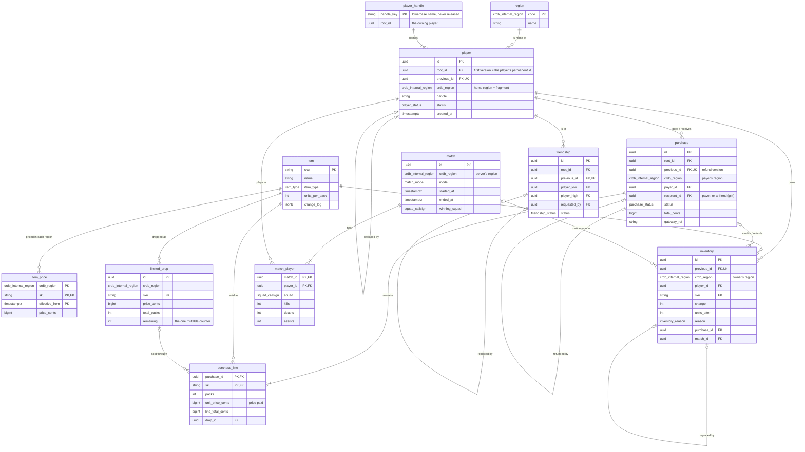

# Squadfire ERD

12 tables in CockroachDB. `PK` primary key, `FK` foreign key, `UK` unique. A line from a table to itself is a **chain**: a new version points to the version it replaces (`previous_id`, unique, so each version is replaced at most once).

**Not drawn as lines:**
- `crdb_region` on the other tables takes its values from `region` too. Only player's home region is drawn, to keep the diagram readable.
- `purchase` has two separate links to `player` (payer and recipient), and `friendship` has three (low, high, requested_by). Each is drawn as one line.
